# 🕹️ Tienda de Videojuegos Retro - UNAHUR

Trabajo Práctico para la materia **Construcción de Interfaces de Usuario** de la Universidad Nacional de Hurlingham.

## Descripción del Proyecto
Aplicación web desarrollada en React que simula una tienda online de videojuegos y consolas retro. Los usuarios pueden explorar un catálogo de productos, filtrar por categorías y precio, consultar detalles, agregar productos al carrito y 
completar una compra simulada.

## Tecnologías Utilizadas
* **React** (Vite)
* **React Router DOM** (Navegación entre vistas)
* **Tailwind CSS / CSS** 
* **Context API & LocalStorage**  

## Instrucciones para instalar y correr el proyecto

1. Clonar el repositorio:
    ```bash
   git clone https://github.com/TyrSain/Tienda-Videojuegos-Retro-tp1-interfaces-de-usuario.git
    ```
2. Entrar a la carpeta del proyecto e instalar dependencias:
    ```bash
    cd Tienda-Videojuegos-Retro-tp1-interfaces-de-usuario
    npm install
    ```
3. Levantar el server em modo desarrollo: 
    ```Bash
    npm run dev
    ```

## Integrantes del Grupo
* Borstner Elea     
* Iribarren Guido  
* Marchese Ximena   
* Nuñez Santiago  

## Capturas de pantalla demostrativas
### Vista Principal (Inicio).

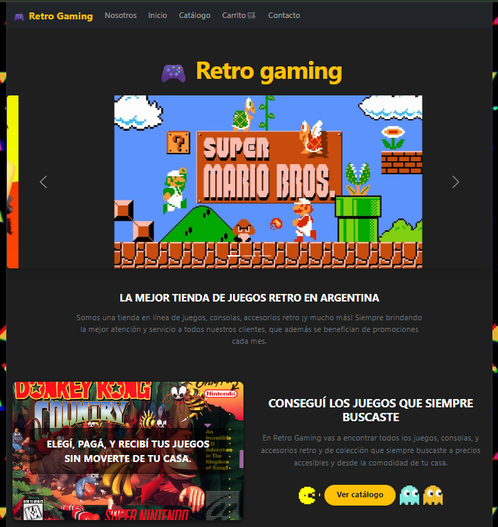 
<br>
La página de inicio cuenta con un banner carrousel que muestra imágenes ilustrativas que llaman la atención del usuario, el nombre de la tienda y una breve descripción. Mediante imágenes y texto promociona servicios de la página y un llamativo botón franqueado por animaciones orienta al usuario a revisar el catálogo.

### Catálogo de Productos y filtrado por categorías.
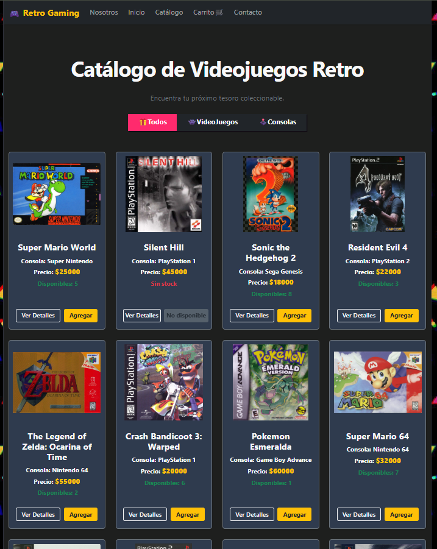
<br>
La página muestra claramente todos los productos en tarjetas, y cuenta con tres botones en el área superior para filtrar el contenido a mostrar según las categorías "Todos", "Videojuegos" y "consolas" permitiendo al usuario revisar cómodamente el catálogo. Cada tarjeta cuenta con una imagen del producto, su nombre, tipo, precio y disponibilidad, así como botones para acceder a más detalles y agregarlo al carrito. Al hacer click en 

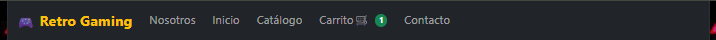
<br>
Al hacer click en el botón "Agregar", el navbar muestra una notificación verde en la esquina superior derecha del ícono del carrito, con la cantidad de productos que éste contiene.

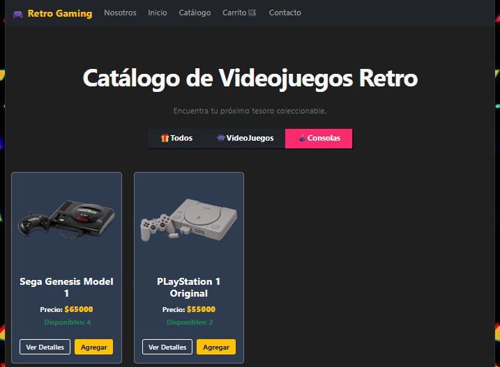
<br>
Al hacer click en alguna de las categorías, el contenido se filtra para mostrar únicamente lo que el usuario pide.

### Detalle de productos y agregado al carrito.
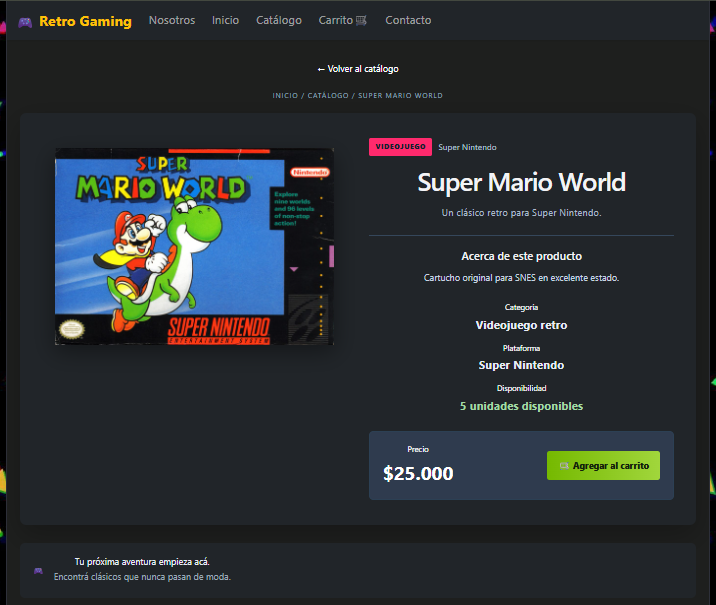
<br>
Al hacer click en el botón "Ver Detalles" del catálogo, el usuario accede a esta página, donde se muestra claramente el producto con información extra relevante para el usuario en la sección "Acerca de este producto". En la parte superior de la página, el usuario puede hacer click en "Volver al catálogo" para regresar a la sección anterior

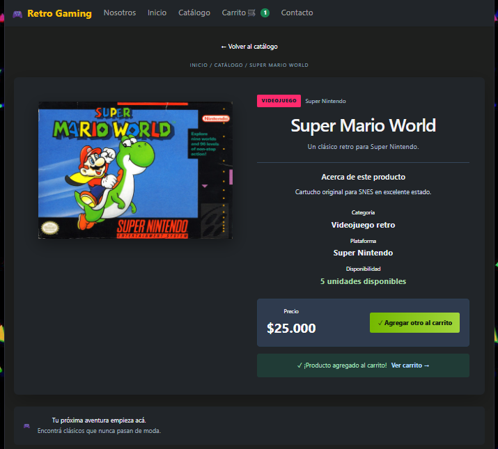
<br>
La página cuenta también con un botón "Agregar al carrito", que al igual que el de la página "Catálogo", agrega el producto al carrito y muestra la cantidad de productos del mismo en una notificación verde en la esquina superior derecha del ícono del carrito.

### Carrito de compras.
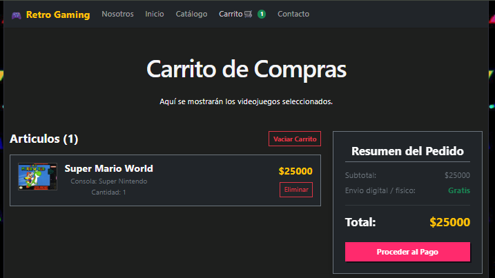
<br>
La página cuenta con un carrito de compras que muestra el producto y la cantidad que han sido seleccionados del catálogo, así como un resumen del pedido con el detalle del subtotal, el envío y un botón para proceder al pago.

### Formulario de compras.
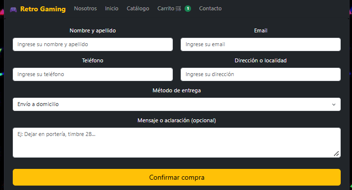
<br>
Al hacer click en el botón "Proceder al Pago", el usuario es redirigido a un formulario de compra con los campos necesarios para completar la compra

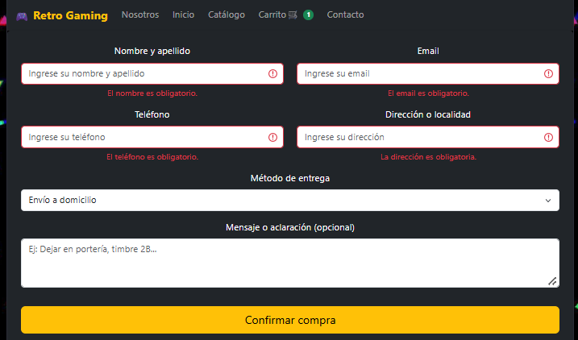
<br>
El formulario no permite la confirmación de la compra si el formulario tiene campos obligatorios vacíos.

### Compra exitosa.
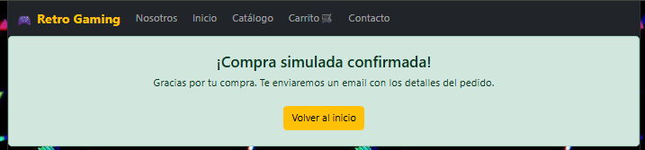
<br>
Al hacer click en el botón "Confirmar compra", el usuario recibe el mensaje "¡Compra simulada confirmada! Gracias por tu compra. Te enviaremos un email con los detalles del pedido" sumado a un botón para volver al inicio.

### Sobre nosotros.
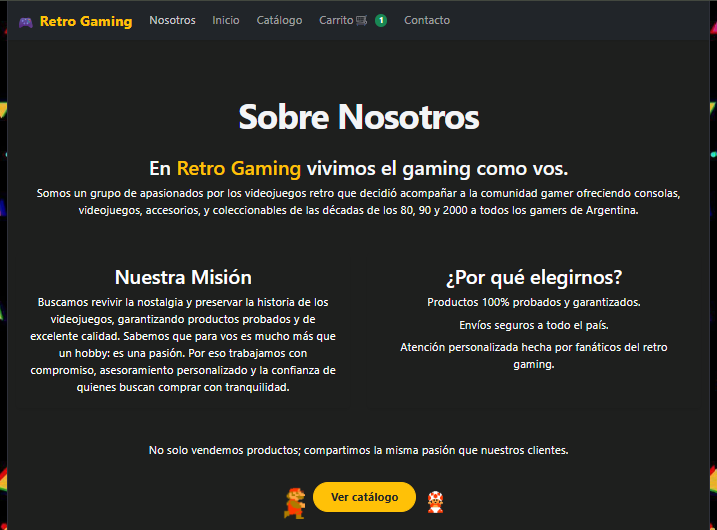
<br>
La página cuenta con una descripción del negocio y el equipo que lo compone, y dos secciones: "Nuestra Misión" y "¿Por qué elegirnos?". La primera se explaya en la motivación del equipo, y la segunda enumera los beneficios de la página, ambas tienen como meta inspirar confianza en el usuario. Esta página cuenta también con un llamativo botón franqueado por dos animaciones que guían al usuario a revisar el catálogo.

